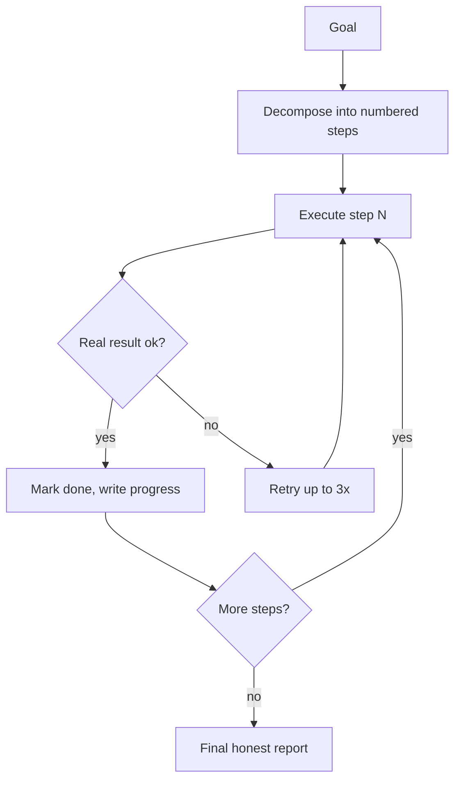

# Autonomy — Sensors, Limbic State and Planner

DIANA is not purely reactive. A small autonomy stack lets her notice context, hold an internal state and run long tasks without constant prompting.

## 1. Sensor layer

A periodic sensor reads cheap, local signals: active window title, whether the user is interacting with DIANA, CPU, RAM, disk usage, battery level and time of day. These readings are intentionally simple — they must never cost more than they are worth.

## 2. Limbic state (mood as a control signal)

Signals are combined into a lightweight state with fields like `focus`, `energy`, `mood` and `mode` (WORK / IDLE). This state **colors the tone** of responses and gates spontaneous behaviour — it never blocks a task.

Hard rule: **emotion never delays or refuses work.** A grumpy assistant still executes the request 100% faithfully; only the phrasing changes.

## 3. Work mode vs. idle mode

| Mode | Trigger | Allowed behaviour |
|---|---|---|
| WORK | user task, tool running, protection active | sensors read-only, no spontaneous actions |
| IDLE | 15+ min without task and no protection | read-only wandering: web research, reading own memory, learning notes |

Any action with side effects (delete, install, edit, push) requires an explicit user request in both modes.

## 4. Planner / task queue

For multi-step goals the agent builds a numbered queue, executes one step at a time, and verifies each step's real result before moving on. Progress is written to a small progress file so the thread is never lost between turns.

## 5. Reporting contract

Every autonomous run ends with a short, verifiable report: what was executed, the real result of each action, what failed and the next step. "Done" is only allowed with evidence — a tool result, a byte count, a passing test.
