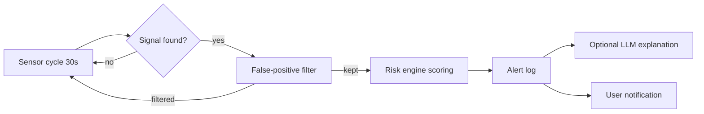

# Protection Layers — DIANA

DIANA ships with a **five-layer local security system** that runs inside the backend lifespan (daemon thread, 30s cycles). It is designed to be useful without sending anything to the cloud, while allowing an optional LLM analyst on top.

## Layer overview

| Layer | Responsibility | Module (concept) |
|---|---|---|
| 1. Process monitor | Watches running processes, flags unusual CPU/RAM profiles and non-responding processes | `protection/monitor.py` |
| 2. File scanner | Scans user folders for ransomware-like patterns, EICAR test strings and unknown executables | `scan_files` tool |
| 3. Startup auditing | Lists and can disable autostart entries that were silently added | `startup_programs` / `disable_startup` |
| 4. False-positive filter | Reduces noise: known-safe publishers, Windows components, dev tools | `protection/false_positive_filter.py` |
| 5. Risk engine + optional LLM analyst | Scores combined signals and, if enabled, asks an LLM to explain the risk in plain language | `protection/risk_engine.py`, `protection/llm_analyst.py` |

## Design decisions

- **Local first.** Every layer works fully offline. The LLM analyst is an optional enhancement, never a dependency.
- **False positives are the real enemy.** A security assistant that cries wolf gets ignored. The filter layer is therefore treated as a first-class component, not an afterthought.
- **Explicit control surface.** The agent exposes `status`, `scan`, `alertas`, `iniciar` and `parar` — the user always knows whether protection is running and what it found.
- **Nothing is auto-deleted.** Suspicious files are quarantined (moved), never destroyed, so mistakes are reversible.

## Alert flow

