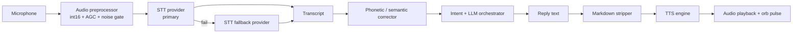

# Voice Pipeline — STT, Correction and TTS

DIANA speaks and listens. The pipeline is deliberately boring on the outside and defensive on the inside: audio in, text out, text in, audio out — with validation and fallbacks at every hop.

## Diagram

## 1. Audio preprocessing

Raw microphone input is normalized to int16 and passed through automatic gain control. This single step fixed the most common real-world failure: quiet microphones producing near-silent float32 audio that no STT engine could transcribe.

## 2. STT with fallback

A primary cloud provider handles transcription; local engines (Whisper, Vosk, Windows Speech) exist as fallbacks and were evaluated for latency and reliability. The chosen default is the one that is *fast and reliable*, not the one that is theoretically best.

## 3. Correction layer

Speech recognition produces predictable mistakes — especially proper nouns and the assistant's own name. A correction table (hundreds of entries) plus a semantic pass repairs the transcript before it reaches the LLM. Without this, a single misheard word can flip an entire command.

## 4. TTS and markdown stripping

Text is stripped of markdown before synthesis. Asterisks were literally being spoken as "asterisk", and code blocks produced nonsense. The stripper is a small but essential part of perceived quality.

## 5. Language mirroring

The assistant answers in the language the user used. A short technical command in English gets an English answer; a Portuguese sentence gets a Portuguese answer. Translation is only produced when explicitly requested.

## 6. Validation of transcripts

Before acting on a transcript, a validator checks whether it is plausible. Clearly corrupted or too-short input triggers a polite request to repeat instead of a random action — acting on garbage is worse than asking again.
